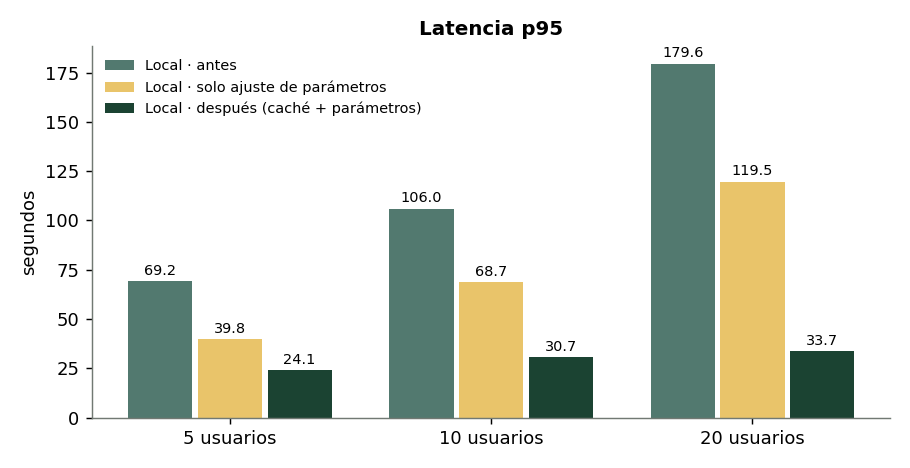

# Reto 08/10 · Pruebas de carga y optimización de backends LLM

Team MIRA · Inetum · 8 de octubre de 2026

## Entregables

| Entregable | Archivo | Estado |
|---|---|---|
| Script de pruebas de estrés (local + remoto) | [`stress_test.py`](stress_test.py) | ✅ Ejecutado en local · ⏳ Azure pendiente de credenciales |
| Optimizaciones (caché, coalescencia, parámetros) | [`gateway.py`](gateway.py) | ✅ |
| Informe antes/después con gráficas | [`informe/INFORME.md`](informe/INFORME.md) | ✅ |

## Resultado principal (Ollama local, Gemma 4 E4B, 20 usuarios)

| | Antes | Después |
|---|---|---|
| Latencia p50 | 119,5 s | **12,7 s** |
| Latencia p95 | 179,6 s | **33,7 s** |
| Errores (timeout) | 13 / 40 | **0** |
| Peticiones/s | 0,083 | **0,99** |



## Uso

```bash
python -m venv .venv && source .venv/bin/activate
pip install -r requirements.txt
cp .env.example .env              # datos de la VM de Azure

# 1. Antes de optimizar
python stress_test.py --backend local --etiqueta antes
python stress_test.py --backend azure --etiqueta antes

# 2. Optimizaciones: gateway con caché + coalescencia + ajuste de parámetros
python gateway.py &                                       # delante de Ollama (:8080)
python stress_test.py --backend gateway --etiqueta despues --vaciar-cache
#   Para Azure: UPSTREAM_URL=http://<vm>:8000 UPSTREAM_API_KEY=... python gateway.py

# 3. Gráficas → informe/img/
python graficas.py
```

### Opciones de `stress_test.py`

| Opción | Por defecto | Descripción |
|---|---|---|
| `--usuarios` | `5 10 20` | Escenarios de usuarios simultáneos |
| `--peticiones` | `2` | Peticiones por usuario |
| `--max-tokens` / `--temperature` | `256` / `0.7` | Parámetros del modelo |
| `--timeout` | `180` | Timeout por petición (s) |
| `--vaciar-cache` | — | Vacía la caché del gateway antes de cada escenario |

### Métricas registradas por escenario

Latencia (media, p50, p95, máx.), errores por tipo, peticiones/s, tokens/s agregados y por petición, aciertos de caché, y CPU (media y máx.) y RAM (sistema y procesos de Ollama), muestreadas cada 0,5 s con `psutil`.

### Configuración de `gateway.py`

| Variable | Por defecto | |
|---|---|---|
| `UPSTREAM_URL` | `http://localhost:11434` | Backend (Ollama o VM de Azure) |
| `GW_MAX_TOKENS` | `128` | Tope de `max_tokens` |
| `GW_TEMPERATURE` | `0.2` | Temperatura forzada |
| `GW_CACHE_SIZE` / `GW_CACHE_TTL` | `500` / `3600` | Entradas y TTL (s) de la caché |

Endpoints: `POST /v1/chat/completions` (con cabecera `X-Cache`), `GET /v1/models`, `GET /stats`, `POST /cache/clear`.
