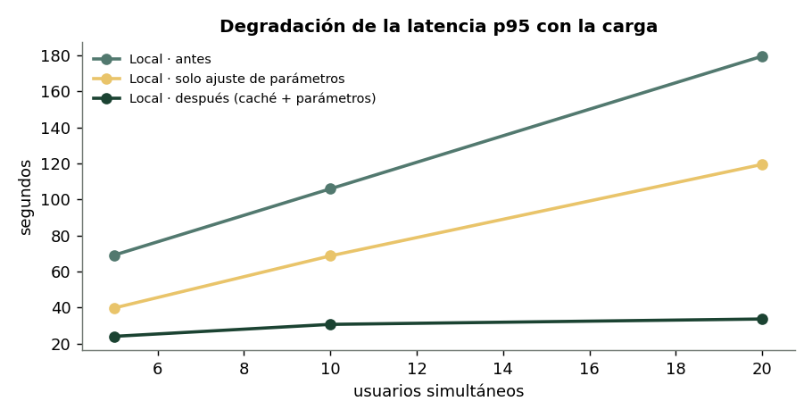
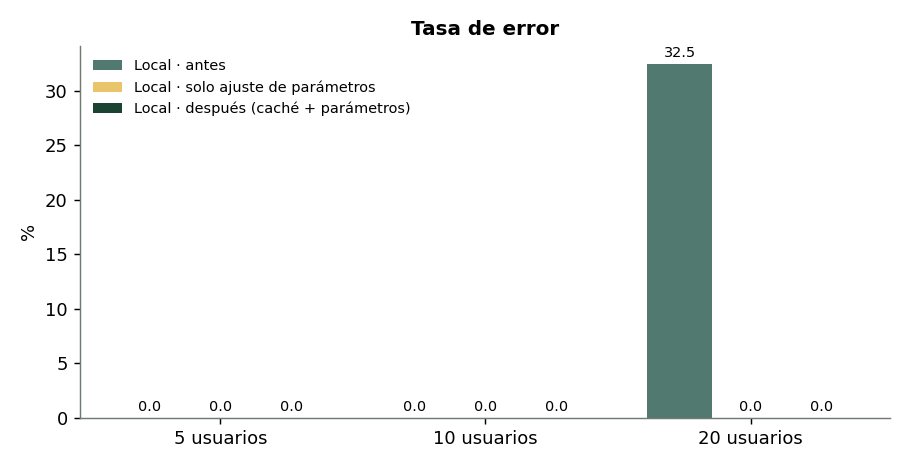
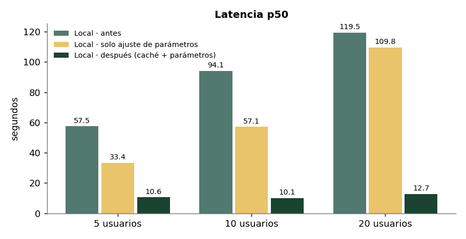
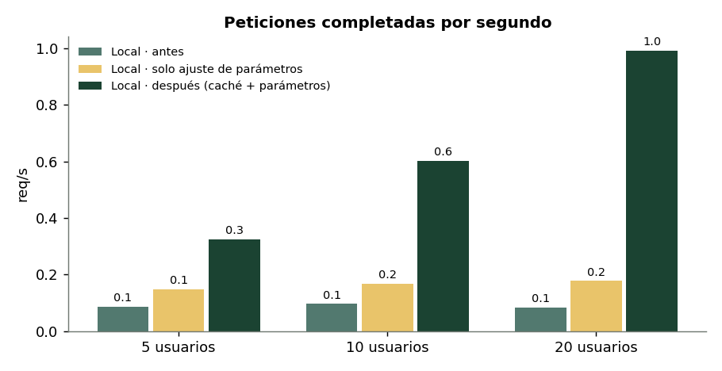
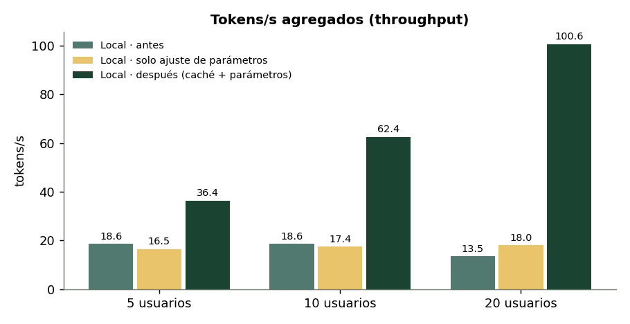

# Informe: pruebas de estrés y optimización

> Reto 08/10/2026 · Team MIRA · Inetum
> Datos en bruto: [`../resultados/`](../resultados) · Gráficas: [`img/`](img)

## 1. Entorno y metodología

| Elemento | Valor |
|---|---|
| Backend local | Ollama 0.35.1 nativo (Metal, 100 % GPU) · `gemma4:e4b` · MacBook Apple M5, 16 GB |
| Backend remoto | VM de Azure. ⏳ **Pendiente:** Inetum no ha proporcionado las credenciales |
| Herramienta | [`stress_test.py`](../stress_test.py): `asyncio` + `aiohttp`, sin límite de conexiones |
| Escenarios | 5, 10 y 20 usuarios simultáneos × 2 peticiones cada uno (10, 20 y 40 peticiones) |
| Carga | 8 preguntas frecuentes con pesos tipo Zipf (unas se repiten mucho más que otras), semilla fija para que se pueda reproducir |
| Timeout | 180 s por petición |
| Recursos | `psutil` cada 0,5 s: CPU del sistema y RAM del sistema y de los procesos `ollama` + `llama-server` |
| Calentamiento | Una petición previa para no medir la carga en frío del modelo |

**Series medidas:**
1. **Antes:** directo a Ollama, `max_tokens=256`, `temperature=0.7`.
2. **Solo ajuste de parámetros:** directo a Ollama, `max_tokens=128`, `temperature=0.2`.
3. **Después:** a través de [`gateway.py`](../gateway.py), con caché, coalescencia y los mismos parámetros que la serie 2. **La caché se vacía al empezar cada escenario** para que sean comparables.

> En una primera ejecución, la caché se quedaba llena de un escenario al siguiente y los de 10 y 20 usuarios salían con una latencia de ~0 s. Ese resultado se descartó por no ser comparable; está en `resultados/descartado_gateway_cache_caliente.json`.

## 2. Resultados antes de optimizar: local vs. remoto

| Escenario | Backend | Lat. media | p50 | p95 | Errores | Req/s | Tok/s agregados | Tok/s por petición | CPU media / máx. | RAM Ollama |
|---|---|---|---|---|---|---|---|---|---|---|
| 5 usuarios | Local | 48,5 s | 57,5 s | 69,2 s | 0 / 10 | 0,087 | 18,6 | 6,4 | 11,9 % / 49 % | 4,63 GB |
| 5 usuarios | Azure | ⏳ | ⏳ | ⏳ | ⏳ | ⏳ | ⏳ | ⏳ | n/a* | n/a* |
| 10 usuarios | Local | 82,0 s | 94,1 s | 106,0 s | 0 / 20 | 0,096 | 18,6 | 3,3 | 9,1 % / 70 % | 4,63 GB |
| 10 usuarios | Azure | ⏳ | ⏳ | ⏳ | ⏳ | ⏳ | ⏳ | ⏳ | n/a* | n/a* |
| 20 usuarios | Local | 107,2 s | 119,5 s | 179,6 s | **13 / 40 (32,5 %) timeout** | 0,083 | 13,5 | 3,0 | 5,3 % / 20 % | 4,67 GB |
| 20 usuarios | Azure | ⏳ | ⏳ | ⏳ | ⏳ | ⏳ | ⏳ | ⏳ | n/a* | n/a* |

\* La CPU y la RAM de la VM no se pueden medir desde el cliente. Habría que tomarlas en la VM con `htop`/`nvidia-smi` o con Azure Monitor.

## 3. Cuellos de botella

### Local: ¿dónde falla primero?

1. **El throughput es plano.** Se mantiene en ~18,6 tok/s y ~0,09 req/s tanto con 5 como con 10 usuarios. Más usuarios no aumentan el trabajo hecho: solo **alargan la cola**. Ollama procesa las peticiones prácticamente **en serie** en la GPU del portátil.
2. **La latencia crece de forma lineal con la carga.** El p50 pasa de 57 s a 94 s y a 120 s. Los tok/s que ve cada usuario se dividen entre los que esperan: 6,4 → 3,3 → 3,0.
3. **El primer fallo aparece con 20 usuarios:** el 32,5 % de las peticiones supera los 180 s de timeout. El cliente abandona mientras el modelo sigue ocupado, así que el throughput útil cae a 13,5 tok/s.
4. **No es la CPU ni la RAM.** La CPU media se queda en el 5-12 % y la RAM de Ollama, estable en ~4,6 GB (el sistema llega a ~9,6 GB de 16). **El cuello de botella es la GPU, es decir, la capacidad de inferencia secuencial**, no la memoria.

### Remoto: hipótesis a validar cuando haya VM

Un servidor con GPU de datacenter y vLLM o TGI aplica *continuous batching*: agrupa peticiones concurrentes en un mismo lote, así que el throughput **aumenta** con la concurrencia hasta saturar la GPU. Es de esperar que falle más tarde y por otros motivos:
- saturación de la memoria de la GPU por la KV cache (contexto × usuarios);
- límites de concurrencia o cuotas del servidor (HTTP 429/503);
- latencia de red, que se nota en las peticiones cortas.

## 4. Optimizaciones implementadas

| # | Optimización | Dónde | Cómo |
|---|---|---|---|
| 1 | **Caché de respuestas frecuentes** | `gateway.py` | LRU de 500 entradas con TTL de 1 h. La clave es el SHA-256 de modelo + mensajes. Cabecera `X-Cache: HIT/MISS` y endpoint `/stats` |
| 2 | **Coalescencia de peticiones (single-flight)** | `gateway.py` | Si llegan N peticiones idénticas a la vez, solo una va al modelo y las demás esperan ese resultado. Evita la avalancha de peticiones antes de que la caché se llene |
| 3 | **Ajuste de parámetros** | `gateway.py` (y prueba aislada) | `max_tokens` de 256 a 128: respuestas más cortas, menos tiempo de GPU por petición. `temperature` de 0,7 a 0,2: respuestas más deterministas y coherentes, adecuadas para cachear |

El gateway es transparente: expone la misma API compatible con OpenAI y puede ponerse delante de Ollama o de la VM de Azure (`UPSTREAM_URL`).

## 5. Antes / después

| Escenario | Métrica | Antes | Solo parámetros | Después (caché + parámetros) | Mejora total |
|---|---|---|---|---|---|
| 5 usuarios | p50 | 57,5 s | 33,4 s | **10,6 s** | **−82 %** |
| | p95 | 69,2 s | 39,8 s | **24,1 s** | −65 % |
| | Duración total | 115 s | 68 s | **31 s** | ×3,7 más rápido |
| | Req/s | 0,087 | 0,148 | **0,325** | ×3,7 |
| | Errores | 0 | 0 | 0 | = |
| 10 usuarios | p50 | 94,1 s | 57,1 s | **10,1 s** | **−89 %** |
| | p95 | 106,0 s | 68,7 s | **30,7 s** | −71 % |
| | Req/s | 0,096 | 0,168 | **0,602** | ×6,3 |
| | Errores | 0 | 0 | 0 | = |
| 20 usuarios | p50 | 119,5 s | 109,8 s | **12,7 s** | **−89 %** |
| | p95 | 179,6 s | 119,5 s | **33,7 s** | −81 % |
| | Req/s | 0,083 | 0,177 | **0,992** | ×12 |
| | Errores | **13 (32,5 %)** | **0** | **0** | **−100 %** |
| | Aciertos de caché | — | — | 33 / 40 (82,5 %) | |

> **Cómo leer los tok/s del gateway:** en la serie «después», los tokens agregados cuentan los **tokens entregados** al usuario, incluidos los servidos desde caché, y por eso superan la capacidad de la GPU (100 tok/s frente a ~18). La columna «tok/s por petición» del JSON no tiene sentido para las respuestas cacheadas, que se sirven en milisegundos.

### Análisis

- **Ajuste de parámetros por sí solo:** reduce la latencia p50 un ~40 % con 5 y 10 usuarios y **elimina los timeouts con 20 usuarios** (p95 −33 %). Con respuestas más cortas, cada petición ocupa menos la GPU y la cola avanza antes. El coste es que las respuestas son menos extensas: hay que validar que 128 tokens bastan para el caso de uso.
- **Caché + coalescencia:** con una carga realista, en la que se repiten preguntas, el 50-82 % de las peticiones no llega al modelo. La latencia deja de crecer con los usuarios (p50 de ~10-13 s en los tres escenarios) y el throughput escala ×12 con 20 usuarios.
- **Lo que no cambia:** las peticiones *nuevas* (fallos de caché) siguen pasando por la misma cola de GPU. Eso explica que el p95 siga en 24-34 s.
- **Recursos:** la RAM de Ollama no varía (~4,6 GB). La caché del gateway ocupa unos pocos KB por entrada.

## 6. Conclusiones y siguientes pasos

1. **En local, el límite es la inferencia secuencial en la GPU del portátil.** Sirve para 1-5 usuarios. A partir de ~10, la latencia ya no es aceptable sin optimizar.
2. **La caché es la optimización más rentable** cuando hay preguntas repetidas (FAQs, asistentes internos). Con coalescencia, protege además ante picos de peticiones iguales.
3. **El ajuste de parámetros es gratuito y elimina los timeouts.** Debería ser lo primero que se configure.
4. **Siguientes optimizaciones posibles:**
   - **`OLLAMA_NUM_PARALLEL`**: procesar varias peticiones a la vez en Ollama. En 16 GB habría que comprobar que la KV cache cabe.
   - **Cuantización más agresiva o un modelo más pequeño** (`gemma4:e2b`) para aumentar los tok/s.
   - **Escalado horizontal** con `deploy.replicas` en Docker Compose detrás de un balanceador. Tiene sentido en un servidor con varias GPU, no en un portátil con una sola.
5. **Pendiente:** ejecutar las mismas series contra la VM de Azure (`--backend azure`) y completar la tabla de la sección 2.
